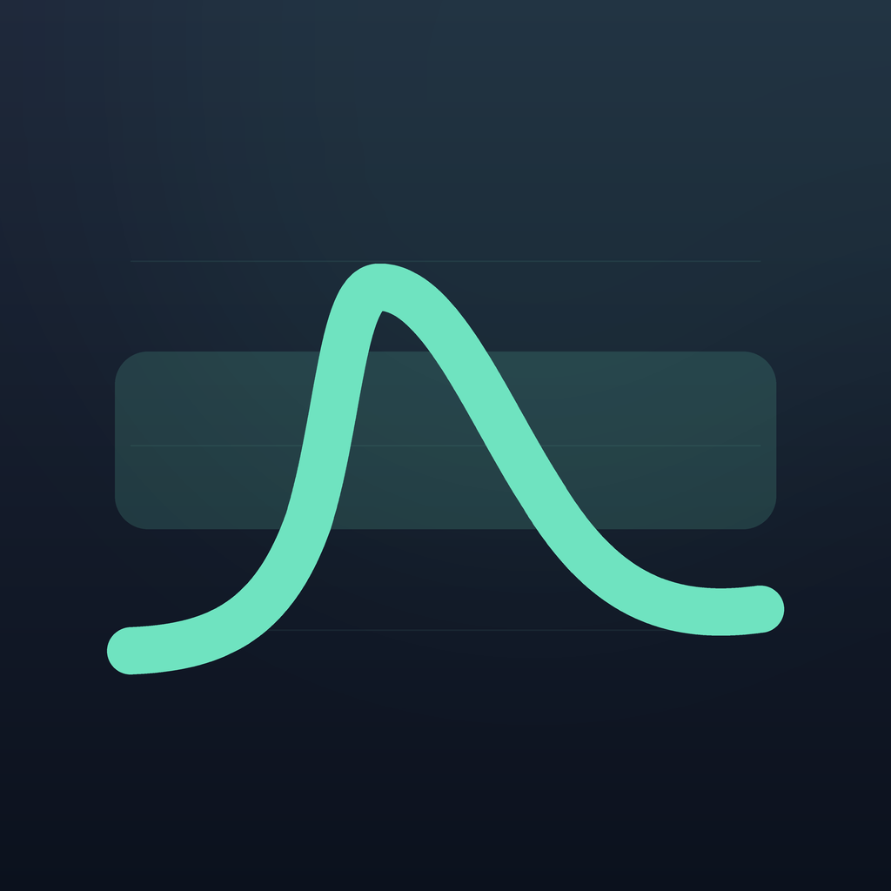

# The mark



A concentration curve inside a target band: one dose absorbed, a rounded peak,
a long decay, and the window the person is trying to stay inside. The same
shape is used by the app, in a warm palette; the library uses graphite and
mint, which reads as "instrument" rather than "consumer app".

| File | Use |
|---|---|
| `logo.svg` | Canonical vector, 1024×1024, rounded corners |
| `logo.png` | 1024×1024 raster, for surfaces that cannot use SVG |
| `logo-256.png` | Small placements, avatars, package listings |
| `social-preview.png` | GitHub *Settings → Social preview* (1280×640) |

## Geometry

Everything is drawn on a 1024×1024 canvas:

- Background: rounded square, corner radius 232 (22.7%).
- Band: `x 132–892`, `y 404–608`, radius 38, mint at 16% opacity.
- Curve: four cubic segments, stroke 54, round caps and joins.

```
M150 748 C244 744 312 718 354 600
        C390 486 392 330 436 330
        C506 330 560 470 622 566
        C688 676 760 716 874 700
```

- Colours: background `#1E273A → #0B111D`, curve `#6FE3C0`, grid `#78DCC3` at
  8%, band `#6FE3C0` at 16%.

There is deliberately no wordmark inside the square and no dot on the apex: at
launcher and favicon sizes a marker turns the curve into a silhouette, and text
becomes a smudge.

## Regenerating

The raster assets are produced by `tool/make_icons.py` in the
[application repository](https://github.com/imisakamikoto/misaka-hrt-tracker),
which draws both marks from the same primitives so they stay in step. The SVG
here is the canonical vector and is edited by hand when the geometry changes.

## Use

The mark is part of the MIT-licensed project; you may use it to refer to this
library (for example "powered by hrt-pk-core"). Please do not use it as the icon
of a different product, and do not imply endorsement by the authors.
